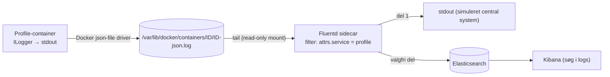
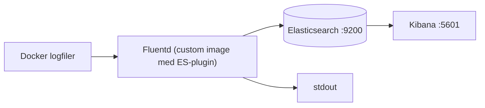

# Sidecar: logging med Fluentd (Bizcord / Profile)

## TL;DR
En **sidecar** er en ekstra container, der kører **ved siden af** en service og tager sig af en tværgående opgave (her: at sende logs videre), så servicen selv kun skal **skrive til stdout**.
Profile ved ikke, at Fluentd findes. Vi kan skifte logging-løsning uden at ændre en linje C#.



## 1. Hvorfor sidecar?
| Uden sidecar | Med sidecar |
|---|---|
| Servicen skal kende log-systemet (bibliotek, adresse, retry, buffering) | Servicen skriver kun til stdout |
| Skift af log-system = ændring i hver service + nyt deploy | Skift af log-system = ændring i Fluentd-config |
| Logikken for at sende logs gentages i alle services og sprog | Én sidecar-konfiguration kan bruges til alle services |

Det er **separation of concerns**: forretningslogik i servicen, drift (log-shipping) i sidecaren.

**Ulemper / trade-offs**
- Ekstra container at drifte og overvåge.
- Mere ressourceforbrug (en sidecar pr. service i en rigtig deployment).
- Her **simulerer** vi en sidecar: Fluentd læser Dockers logfiler på hosten. I Kubernetes ville sidecaren ligge i samme pod og dele en volume med servicen.

## 2. Hvad skal der til? (del 1)
1. **Servicen skriver til stdout.** ASP.NET Core gør det som standard via `ILogger` → konsol. Ingen kodeændring.
2. **Docker gemmer stdout** som JSON-linjer i en fil pr. container (`json-file` driver).
3. **Fluentd læser filerne** (`tail`), filtrerer og printer dem (`stdout`).

### `fluentd/fluent.conf` (del 1)
```conf
<source>
  @type tail
  path /fluentd/log/containers/*/*.log
  pos_file /fluentd/log/fluentd-docker.pos
  tag docker.*
  read_from_head true
  <parse>
    @type json
  </parse>
</source>

<filter docker.**>
  @type grep
  <regexp>
    key $.attrs.service
    pattern /^profile$/
  </regexp>
</filter>

<match **>
  @type stdout
</match>
```

| Del | Hvad den gør |
|---|---|
| `<source> @type tail` | Følger filerne, som `tail -f`. Husker position i `pos_file`, så den ikke læser det samme to gange |
| `path .../*/*.log` | Alle containeres logfiler (mappe pr. container-id) |
| `tag docker.*` | Giver hver record et tag, som `match`/`filter` bruger til routing |
| `read_from_head true` | Læs fra starten af filen, ikke kun nye linjer |
| `<parse> @type json` | Hver linje er JSON: `log`, `stream`, `time`, `attrs` |
| `<filter> grep` | Behold kun records hvor `attrs.service == profile` |
| `<match **> stdout` | Print alt der er tilbage. Her bytter vi senere stdout ud med Elasticsearch |

### Ændringer i `docker-compose.yml` (del 1)
```yaml
  fluentd:
    image: fluent/fluentd:latest
    container_name: fluentd
    user: root
    ports:
      - "24224:24224"
      - "24224:24224/udp"
    volumes:
      - ./fluentd/fluent.conf:/fluentd/etc/fluent.conf:ro
      - /var/lib/docker/containers:/fluentd/log/containers:ro
    environment:
      - FLUENTD_CONF=fluent.conf

  profilemicroservice:
    # ... eksisterende indstillinger ...
    logging:
      driver: "json-file"
      options:
        labels: "service"
    labels:
      service: "profile"
    depends_on:
      rabbitmq:
        condition: service_healthy
      vault:
        condition: service_started
      fluentd:
        condition: service_started
```

### Hvorfor `user: root`?
Dockers logfiler ejes af root. Fluentd-imaget kører som en almindelig bruger og får "permission denied".

### Hvorfor `labels` + `grep`-filter? (to formål)
1. **Scope:** kun Profile-logs sendes videre. RabbitMQ og Vault skal ikke med.
2. **Undgå uendelig løkke:** Fluentd printer til sin egen stdout. Den stdout ligger i `/var/lib/docker/containers`, som Fluentd selv læser. Uden filter læser den sine egne linjer, printer dem igen, læser dem igen osv. Fluentds container har intet `service`-label, så filteret smider dens egne linjer væk.

## 3. Valgfri del: central log-database (Elasticsearch + Kibana)

Vi bytter `stdout` ud med (eller supplerer med) **Elasticsearch**, og bruger **Kibana** til at søge i logs. Mønsteret kaldes **EFK** (Elasticsearch, Fluentd, Kibana).



- Fluentd-imaget har ikke Elasticsearch-pluginet, så vi bygger vores eget image (`fluentd/Dockerfile`) med gem'en `fluent-plugin-elasticsearch`.
- `<match>` bliver til `@type copy` med to `<store>`: Elasticsearch og stdout.
- Fluentd skal vente, til Elasticsearch er klar (`depends_on` med `condition: service_healthy`).
- Elasticsearch kører her uden sikkerhed (`xpack.security.enabled=false`). Det er **kun til udvikling**.

## 4. Alternativ: Dockers `fluentd` logging-driver (artiklen i opgaven)
I Fluentd-artiklen bruger servicen `logging: driver: "fluentd"` og **Docker sender selv** logs til Fluentd på port 24224 (input `@type forward`).

| | `tail` af json-filer (vores) | `fluentd` logging-driver |
|---|---|---|
| Hvem sender | Fluentd henter selv fra filer | Docker skubber logs til Fluentd |
| Krav | Adgang til hostens Docker-logmappe (root) | Fluentd skal køre, før servicen starter |
| Kobling | Servicen kender slet ikke Fluentd | Compose-filen peger på Fluentd-adressen |

## Eksamens-checkliste
- [ ] Hvad er en sidecar, og hvilket problem løser den?
- [ ] Hvilke fordele og ulemper har den (ekstra container, ressourcer)?
- [ ] Hvorfor skriver servicen kun til stdout?
- [ ] Hvad gør `source`, `filter` og `match` i Fluentd?
- [ ] Hvorfor skal Fluentd køre som root, og hvorfor opstår logløkken uden filter?
- [ ] Forskellen på `tail` af logfiler og Dockers `fluentd`-driver
- [ ] Hvad er EFK, og hvorfor er Elasticsearch bedre end en konsol til logs?

