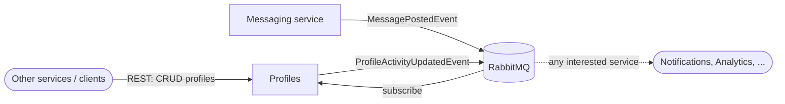

# Analysis & Design: Profile Microservice (Bizcord)

## 1. Domain and context

Bizcord is a Discord-like real-time communication platform (backend only). The overall
scope is real-time communication, channel management, user profiles and engagement. Each
team owns one bounded context. **Our bounded context is User Profiles.** See
`diagrams/Bizcord microservices DDD.drawio` for the coarse system overview (Servers,
Profiles, Messaging).

## 2. Responsibility

The Profile service is responsible for user profiles and their friend list: creating,
reading, updating and deleting profiles, and keeping simple profile activity data up to date.

## 3. Data ownership

| Data | Owner | Notes |
|------|-------|-------|
| Profile (id, displayName, createdAt, lastMessageAt) | Profiles | Single source of truth |
| Friend (id, displayName, createdAt) | Profiles | Our own private copy of another profile's basic data |
| Messages, channels, presence, notifications | Other services | Never stored or modified here |

Each microservice may have its own private version of an entity. `Friend` is exactly that:
a read-only copy that does not make Profiles the owner of someone else's data.

## 4. Boundaries

- Profiles knows nothing about message content, channels or permissions.
- Other services reference a profile only by its id and fetch details through our REST API.
- The shared model (`ProfileDto`) exposes only `Id`, `DisplayName` and `CreatedAt`.
  Internal data (friends, `LastMessageAt`) is hidden.
- No other service reads our data store; access goes through the REST API or events.

## 5. Interactions

| Direction | Style | What | Why |
|-----------|-------|------|-----|
| Other services → Profiles | REST (sync) | `GET/POST/PUT/DELETE /api/profiles` | Immediate answer needed |
| Messaging → Profiles | Event (async) | `MessagePostedEvent` | Loose coupling; Messaging does not know we exist |
| Profiles → anyone | Event (async) | `ProfileActivityUpdatedEvent` | Lets other services react without us knowing them |

## 6. Events

| Event | Published by | Consumed by | Key fields |
|-------|--------------|-------------|------------|
| `MessagePostedEvent` | Messaging | Profiles (and others) | MessageId, ChannelId, AuthorId, Content, PostedAt |
| `ProfileActivityUpdatedEvent` | Profiles | Any interested service | MessageId, ProfileId, LastMessageAt, ProcessedAt |

The handler is idempotent (`LastMessageAt` only moves forward), because the broker may
deliver a message more than once or out of order. `MessageId` is carried through for traceability.

## 7. Trade-offs

- **In-memory storage:** profiles are lost on restart. A database per service replaces it later.
- **Eventual consistency:** `LastMessageAt` lags behind the message by the broker delay. Accepted for loose coupling.
- **Shared contract library:** shared event types couple services at compile time. 
  This is intended: it enforces message shape, while contract tests verify values.
- **No outbox:** if RabbitMQ is down while we publish, the result event is lost. An outbox would fix it.