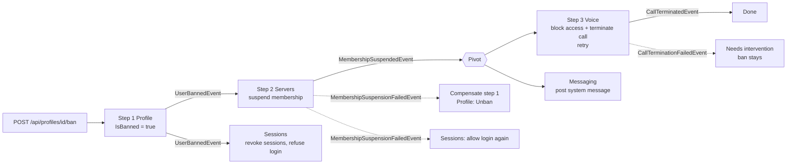

# Saga: Banning a user mid-conversation (Bizcord)

Task 01 – Saga Workflow Scenarios. Scenario chosen: **"A user gets banned mid-conversation"**.

## 1. Scope

Bizcord is a Discord-like platform. Our bounded context is **Profiles**. The scenario spans contexts from `docs/analysis-and-design.md`. The scenario text names three responsibilities, and this is how they map to our code:

| Scenario responsibility | Context | Owner | In this repo |
|---|---|---|---|
| User Management: mark banned + invalidate sessions | Profiles | Our team | `apps/Profile-Microservice` (real) + `SessionWorker` (stub) |
| Channel: remove from channels + system message | Servers (memberships), Messaging | Other teams | `ServersWorker` and `MessagingWorker` (stubs) |
| Streaming / VOIP: terminate calls | Voice (part of Servers) | Other team | `VoiceWorker` (stub) |

All stubs live in `apps/Servers-Stub`. They are small background workers that behave like the real services over RabbitMQ, so the saga can be demonstrated end to end. Their state is in memory.

**Simplifications (see section 9):** the real `Auth-Service` does not consume ban events, so `SessionWorker` only simulates session revocation. "Channel membership" is modelled as one membership per user in `ServersWorker`.

## 2. The saga

| Step | Service | Action | Compensation | Reversible? | Type |
|---|---|---|---|---|---|
| 1 | Profile | Mark profile banned (`IsBanned`, `BannedAt`) | Unban (`IsBanned = false`) | Yes | Compensable |
| 1b | Sessions (stub) | Revoke sessions, refuse new logins | Allow login again. Old sessions stay revoked, the user must log in again | Almost: old sessions cannot be revived | Compensable |
| 2 | Servers | Set membership to `suspended` (rows are kept, not deleted) | Set membership back to `active` | Yes, because no data is deleted | Compensable (last one before the pivot) |
| 2b | Messaging (stub) | Post system message "user was removed" | Delete the system message. Some participants may already have seen it | Partly | Compensable |
| 3 | Voice | Block voice access, then terminate the active call (retry) | Restore voice access and inform participants | **No**: the call is gone for good | Retryable |

## 3. Events

All events are in `Shared/Bizcord.Shared/Events`. Names are past tense: an event is a fact that has happened. Every event carries a correlation id (`BanId` / `UnbanId`) so one saga can be followed across services.

| Event | Published by | Consumed by | Meaning |
|---|---|---|---|
| `UserBannedEvent` | Profile (ban endpoint) | Servers, Sessions, Profile (state tracker) | Step 1 succeeded |
| `MembershipSuspendedEvent` | Servers | Voice, Messaging, Profile (state tracker) | Step 2 succeeded |
| `MembershipSuspensionFailedEvent` | Servers | Profile (unban + state), Sessions | Step 2 failed on a business rule, so compensate step 1 |
| `CallTerminatedEvent` | Voice | Profile (state tracker) | Step 3 succeeded, saga complete |
| `CallTerminationFailedEvent` | Voice | Profile (state tracker) | Step 3 gave up after all attempts, needs a human |
| `UserUnbannedEvent` | Profile (unban endpoint) | Servers, Sessions | A moderator lifted the ban, so compensate the other steps |
| `MembershipReactivatedEvent` | Servers | Voice, Messaging | Membership active again |

When step 2 fails, Profile unbans directly in `MembershipSuspensionFailedHandler` and does **not** publish `UserUnbannedEvent`. Servers never suspended the membership, so there is nothing for it to reactivate. Sessions reacts to `MembershipSuspensionFailedEvent` itself.

## 4. The four analysis questions

### 4.1 Consistency guarantees and coupling
- The saga gives **eventual consistency**, not atomicity (Newman p. 183). Each step is a local ACID transaction in its own service.
- There is **no isolation** between steps. While the saga runs, a user can be banned in Profile but still a member in Servers. `IsBanned` in Profile is the single source of truth, and Servers follows it.
- Coupling is kept low: services only share event contracts in `Shared`. Profile knows nothing about Servers (design rule in `analysis-and-design.md`).

### 4.2 Orchestration vs. choreography
**Current implementation: choreography.** (Revisited in Task 02, see `saga-task02.md`.)
- Newman (p. 195): one team owning the whole saga is fine with orchestration; with **several teams** he prefers choreography. Here Profile is ours, while Servers and Messaging belong to other teams.
- Services react to events and no service knows the others. No central component can become a single point of failure or absorb domain logic.
- **Cost:** the process is implicit in the event flow. We mitigate with a correlation id on every event and a state view in Profile (section 5.1).
- An orchestrator was the alternative: it would give one place for state and for the forward/backward decision, at the price of domain coupling to Servers.

### 4.3 Can it be reversed?
- Steps 1, 1b and 2: yes (unban, allow login, reactivate). Old sessions cannot be revived.
- Messaging: the system message can be deleted, but some participants may already have seen it.
- Step 3: **no**. A terminated call cannot be restored. The compensation is *semantic* (Newman p. 187): give access back and tell the participants (`VoiceWorker` logs "Notify participants" on reactivation).
- Consequence for the order: the irreversible step is **last** (Newman p. 188: move hard-to-compensate steps later).

### 4.4 How does it fail?

| Failure | Kind | Handling |
|---|---|---|
| User does not exist | Business | `404 NotFound`, saga does not start |
| User already banned | Business | `409 Conflict`, saga does not start |
| Servers refuses to suspend membership | Business | `MembershipSuspensionFailedEvent` → Profile unbans, Sessions allows login (**backward recovery**) |
| Voice call termination times out | Technical | Retry with exponential backoff, 1 s then 2 s then 4 s (**forward recovery**) |
| All 4 attempts fail | Technical | `ALERT` log and `CallTerminationFailedEvent`. State becomes `NeedsIntervention`. The ban **stays** |
| RabbitMQ unreachable at publish | Technical | Publish times out after 5 s (existing `MessageClient`), error propagates |

A saga handles *business* failures. Technical failures are handled with timeouts and retries (Newman p. 185).

## 5. Pivot, recovery and saga state

- **Pivot:** the point where step 2 has succeeded. After that, we only move forward.
- **Backward recovery** (compensate): used when step 2 fails on a business rule.
- **Forward recovery** (retry): used for the voice step. Termination is **idempotent**, so ending a call that is already gone is not an error.
- **Hard question: "if the ban succeeds but voice termination fails, is the user banned?"** Yes. The ban is a moderator's decision and is already committed. A technical failure in Voice must not undo it. The system is then in the state "banned, membership suspended, call possibly still active". Voice publishes `CallTerminationFailedEvent`, the state becomes `NeedsIntervention`, and an operator alert is logged.
- **What do you tell the other participants?** When voice access is restored, `VoiceWorker` states that the previous call was ended and will not resume.

### 5.1 Saga state view
Profile builds a state per `BanId` from the events (a projection, Newman p. 193-194). It is readable with `GET /api/bans/{banId}`.

| State | Set by |
|---|---|
| `Started` | `UserBannedEvent` |
| `Suspended` | `MembershipSuspendedEvent` |
| `Completed` | `CallTerminatedEvent` |
| `Compensated` | `MembershipSuspensionFailedEvent` (after the unban) |
| `NeedsIntervention` | `CallTerminationFailedEvent` |

`BanSagaTracker` only moves a state forward (`Started` then `Suspended` then a final state) and never overwrites a final state. A late or duplicated message therefore cannot corrupt the state. The state is in memory (see section 9).

## 6. Idempotency

Messages are delivered at least once, so duplicates are possible.
- `Ban` on an already banned user returns `AlreadyBanned` and changes nothing.
- `Unban` can run repeatedly with the same result.
- Setting a membership to `active`/`suspended`, a voice-block flag and a login-block flag are repeatable operations.
- `MessagingWorker` ignores a second `MembershipSuspendedEvent` for the same user.
- Retried voice termination is safe to repeat.

## 7. Test configuration (stub switches)

| Setting | Effect |
|---|---|
| `Stub__FailSuspension=true` | Servers refuses suspension (simulated business failure) |
| `Stub__VoiceFailures=N` | The first N voice termination attempts throw a simulated `TimeoutException` |

## 8. Test results

These were **manual end-to-end runs** against RabbitMQ with `Servers-Stub` running. There are no automated tests for the saga in the repository.

| Test | Setup | Result |
|---|---|---|
| A | Servers succeeds | `isBanned = true`, Servers received `UserBannedEvent` |
| B | `FailSuspension=true` | `isBanned = false` after compensation |
| C1 | Ban twice | `409 Conflict` |
| C2 | Ban unknown id | `404 NotFound` |
| D | `VoiceFailures=2` | Attempts 1 and 2 fail (waits 1 s and 2 s), attempt 3 succeeds, `isBanned = true` |
| E | `VoiceFailures=4` | `ALERT ... Manual intervention required`, no `CallTerminatedEvent`, `isBanned = true` |
| F | Ban, then unban | `isBanned = false`; Servers reactivates, Voice restores access and notifies participants |
| G | Unban unknown id | `404 NotFound` |

[TODO: add the results for Sessions, Messaging and `GET /api/bans/{banId}` once they are run and recorded.]

## 9. Limitations and future work

- **Session invalidation** is simulated by `SessionWorker`. The real `Auth-Service` does not consume ban events, so tokens that are already issued are not revoked.
- **Messaging** is a stub that only logs the system message.
- **Servers, Voice, Messaging and Sessions are stubs** with in-memory state.
- **Profiles and saga state are in memory** (known failure point F3 in `FAILURE-POINTS.md`). A restart loses both.
- **Not atomic:** the ban is saved and then the event is published. If publishing fails, the ban stands but the saga does not continue. A durable **outbox** is the fix (known failure point F4).
- The saga state is one enum value per saga, not one flag per step with timestamps.
- The unban endpoint does not check whether the user was banned, so a repeated unban publishes `UserUnbannedEvent` again. This is harmless because all handlers are idempotent.
