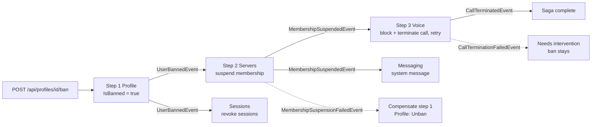

# Task 02: Saga with our own MessageClient (ban scenario)

Scenario: **a user is banned mid-conversation** (same workflow as Task 01, see `saga-ban-user.md`).
No saga framework is used. The coordination logic is implemented by hand on top of the existing `IMessageClient` / `IMessageHandler<T>` / RabbitMQ (EasyNetQ). This is the work a framework like Rebus does for you: correlation, state, routing of messages to handlers, retries.

## 1. Design first

### Happy path and failure paths



### Step by step (the four questions from the assignment)

```
Step 1: Ban profile (Profile)
  Started by:    HTTP command POST /api/profiles/{id}/ban (not a message)
  Success:       UserBannedEvent
  Failure:       404 (user unknown) or 409 (already banned). The saga never starts, nothing to compensate.
  Compensation:  Unban (IsBanned = false), triggered by MembershipSuspensionFailedEvent.
                 The user must log in again, old sessions cannot be revived.

Step 2: Suspend membership (Servers)
  Started by:    UserBannedEvent
  Success:       MembershipSuspendedEvent
  Failure:       MembershipSuspensionFailedEvent  (must compensate step 1)
  Compensation:  Set membership back to active, triggered by UserUnbannedEvent.
                 Servers publishes MembershipReactivatedEvent.

Step 3: Block voice access and terminate call (Voice)
  Started by:    MembershipSuspendedEvent
  Success:       CallTerminatedEvent  (saga complete)
  Failure:       Technical timeout. Retried 4 times with exponential backoff (forward recovery).
                 If all attempts fail: CallTerminationFailedEvent (needs manual intervention). The ban STAYS.
  Compensation:  Semantic only. Restore voice access and notify participants.
                 A terminated call cannot be restored. This is the irreversible step, so it is last.

Side branches (not part of the success condition):
  Messaging: posts "user was removed". Compensation: delete the system message (some participants may already have seen it).
  Sessions:  revokes sessions, refuses new logins. Compensation: allow login again (also after MembershipSuspensionFailedEvent).
```

## 2. Messages

All messages are in `Shared/Bizcord.Shared/Events`. The correlation id on every message is the **SagaId** of the assignment. In our code it is called `BanId` (ban) or `UnbanId` (unban), because that is the domain word.

| Assignment name | Our message | Meaning |
|---|---|---|
| `InitiatePurchase` (command) | HTTP `POST /ban` | Starts the saga |
| step 1 success | `UserBannedEvent` | Profile banned the user |
| `PaymentSucceeded` | `MembershipSuspendedEvent` | Step 2 succeeded |
| `AccountActivationFailed` | `MembershipSuspensionFailedEvent` | Step 2 failed, compensate step 1 |
| `EmailSent` (complete) | `CallTerminatedEvent` | Step 3 succeeded, saga complete |
| (no equivalent) | `CallTerminationFailedEvent` | Step 3 gave up, needs a human |
| `RefundPayment` (compensation) | `UserUnbannedEvent` | Lift the ban, compensate steps 2 and 3 |
| (compensation done) | `MembershipReactivatedEvent` | Membership active again |

Every message carries the correlation id, so one saga can be followed across services in the logs.

Difference from the assignment text: the assignment's orchestration example mixes **commands** (`ChargeCard`) and events. In choreography there are **only events**: a service announces what happened and does not tell others what to do.

## 3. Saga state

The assignment's `PurchaseSagaState` / `ISagaStateRepository` maps to:

| Assignment | Ours |
|---|---|
| `PurchaseSagaState` | `BanSagaState` enum: `Started`, `Suspended`, `Completed`, `Compensated`, `NeedsIntervention` |
| `ISagaStateRepository` | `IBanSagaTracker` (`Record(banId, state)`, `Get(banId)`) |
| load state, mark step, save | `BanSagaTrackingHandlers` (one handler per event) |
| read the state | `GET /api/bans/{banId}` |

**Where it lives and why:** in the **Profile** service. Profile is our bounded context and the service that starts the saga, so it is the natural owner of "what happened to this ban". The state is a **projection of the events** (Newman p. 193-194: a dedicated component consumes the events and builds a view of each saga). The participating services (Servers, Voice) stay stateless with respect to the saga and only keep their own domain data.

**Why forward-only transitions:** messages are delivered at least once and not always in order. `Record` only moves a state forward (`Started` -> `Suspended` -> terminal) and never overwrites a terminal state. A late or duplicated event therefore cannot corrupt the state.

## 4. Choice: choreography

**Why choreography for our domain**
- Several teams are involved. Profile is ours, Servers (memberships, voice) and Messaging belong to other teams. Newman (p. 195) prefers choreography when several teams are involved, because loose coupling gives isolation between teams.
- Profile must not know the other services (design rule in `analysis-and-design.md`). With orchestration, Profile would have to send commands to Servers, Voice and Messaging, which is domain coupling.
- Several services react to the same event without knowing each other (Servers, Sessions and Profile's tracker all consume `UserBannedEvent`). Adding a new reaction later does not change existing code.

**What would be harder with orchestration**
- An orchestrator must know every participant and would sit in our service or in a new one that all teams depend on.
- Logic is pulled into the orchestrator and the other services become anemic (Newman p. 191).
- A single point of failure: if the orchestrator is down, no ban saga progresses.

**What is harder with choreography (the cost)**
- The process is implicit in the chain of events and not modelled in one place.
- There is no central saga state. We mitigate it with the correlation id on every event and the state projection in Profile.
- Compensation is spread across services (each service owns its own compensation).

## 5. What a framework (Rebus) would have done for us

| Concern | Hand-made here | Framework |
|---|---|---|
| Correlation | `BanId` on every event, used by the tracker | Saga data is correlated on a property of the message |
| State persistence | `BanSagaTracker` (in memory) | Saga data storage (SQL, etc.) |
| Routing | `AddMessageHandler<TMessage, THandler>` with a subscription id | Saga handlers are routed automatically |
| Retry | Exponential backoff in `VoiceWorker`, retry in the handler host | Built-in retries and error queue |
| Idempotency | Idempotent operations and forward-only state | Idempotency is still our responsibility |

## 6. Limitations

- State is **in memory** and lost on restart (Profiles are also in memory, failure point F3). A real version stores it in a database.
- No **outbox**: the ban is saved, then the event is published. If publishing fails, the saga does not continue (failure point F4).
- Servers, Voice, Messaging and Sessions are **stubs** with in-memory state.
- The tracker stores one enum value per saga. The assignment's `PurchaseSagaState` stores one flag per step plus timestamps. That is a richer model and can replace the enum if more detail is needed.
