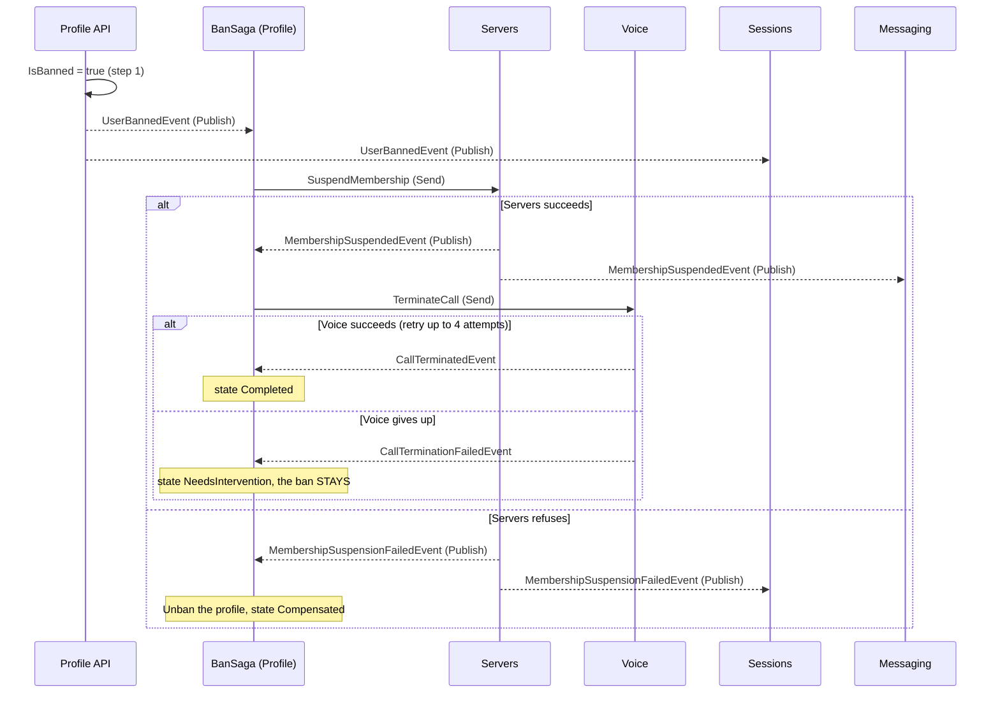

# Task 02: Saga with Rebus (ban scenario)

Scenario: **a user is banned mid-conversation** (same workflow as Task 01, see `saga-ban-user.md`).
This time the saga is implemented with **Rebus** as an **orchestrated saga** that lives in the Profile service (`apps/Profile-Microservice/src/Sagas/BanSaga.cs`).

**Note on the assignment text.** The title of Task 02 asks for the saga pattern "using Rebus". The body of the task describes a hand-made message client with a `SagaId`, a `PurchaseSagaState` and an `ISagaStateRepository`. We implemented the Rebus version and mapped the assignment's concepts onto it (section 3). The earlier hand-made choreography from Task 01 is still in git history. Its tracking handlers are still in `Profile-Microservice/src/Handlers` but are **not registered** any more.

## 1. Design



The saga makes the decisions: send the next command, compensate, or finish. The participants only do their own work and report what happened.

| Step | Who | Action | Compensation |
|---|---|---|---|
| 1 | Profile | `IsBanned = true`, publish `UserBannedEvent` (starts the saga) | Unban, done by the saga |
| 2 | Servers (stub) | Handle `SuspendMembership` | Not needed. If it fails, nothing was suspended |
| 3 | Voice (stub) | Handle `TerminateCall`, 4 attempts with backoff 1 s, 2 s, 4 s | Semantic only. A terminated call cannot be restored. This is the irreversible step, so it is last |
| side | Sessions (stub) | Revoke sessions on `UserBannedEvent`, allow login again on `MembershipSuspensionFailedEvent` | same event |
| side | Messaging (stub) | Post a system message on `MembershipSuspendedEvent` | Delete it on unban (EasyNetQ flow) |

## 2. Messages

All in `Shared/Bizcord.Shared`. Every message carries `BanId` (our saga id) and `UserId`.

| Message | Kind | How it is sent | Receiver |
|---|---|---|---|
| `SuspendMembership` | **Command** (`Commands/`) | `Send`, routed to queue `servers-stub` | Servers |
| `TerminateCall` | **Command** (`Commands/`) | `Send`, routed to queue `servers-stub` | Voice |
| `UserBannedEvent` | Event | `Publish` from the ban endpoint | Saga, Sessions |
| `MembershipSuspendedEvent` | Event | `Publish` | Saga, Messaging |
| `MembershipSuspensionFailedEvent` | Event | `Publish` | Saga, Sessions |
| `CallTerminatedEvent` | Event | `Publish` | Saga |
| `CallTerminationFailedEvent` | Event | `Publish` | Saga |

A **command** tells one known receiver what to do (`Send`). An **event** announces a fact to whoever is interested (`Publish`/`Subscribe`). Orchestration needs commands, which is the difference to the choreography version (events only).

## 3. Saga state

| Assignment | Ours |
|---|---|
| `SagaId` | `BanId` (the domain word for the same idea) |
| `PurchaseSagaState` | `BanSagaData` (`Sagas/BanSagaData.cs`): `BanId`, `UserId`, `MembershipSuspended`, `CallTerminated`, `IsCompleted`, `IsFailed`, `FailureReason`, `StartedAt`, `CompletedAt` |
| `ISagaStateRepository` | Rebus saga storage. We use `StoreInMemory()` |
| "load state, mark step, save" | Rebus does this around every `Handle` call |

How Rebus ties messages to one saga: `CorrelateMessages` declares `config.Correlate<Msg>(m => m.BanId, d => d.BanId)` for each message. Rebus looks up the saga data whose `BanId` equals the message's `BanId`. `IAmInitiatedBy<UserBannedEvent>` means that message creates a new saga. `MarkAsComplete()` ends the saga and removes its data.

`GET /api/bans/{banId}` still reads `BanSagaTracker`, a small read model with the states `Started`, `Suspended`, `Completed`, `Compensated`, `NeedsIntervention`. The saga writes to it. It is a deliberate duplicate: Rebus saga data is removed when the saga completes, but the endpoint should still be able to answer afterwards.

## 4. Justify Your Choice

### Why orchestration with Rebus
- **The assignment asks for Rebus.** A Rebus saga is an orchestrator by nature: one class with its own data that receives the messages and decides what happens next.
- **The ban has an order and decisions.** Step 2 must succeed before step 3 starts. If step 2 fails we compensate step 1. If step 3 fails we keep the ban and raise an alert. All of this is now in **one class** (`BanSaga`), which can be read top to bottom.

### What was harder with choreography (our Task 01 version)
- The process was **implicit** in a chain of events. To understand a ban you had to read several handlers in several services.
- The state had to be **rebuilt from the events** (four tracking handlers plus one compensation handler), and the decision to compensate lived in a separate handler. Sessions also had to react to the failure event on its own.
- To add a step you had to touch the event chain, and it was not obvious where the process ends.

### Where the state lives and why
- In the **Profile** service, in `BanSagaData`. Profile owns the ban, starts the saga, and the only compensation the saga performs (`Unban`) is a Profile operation. Servers and Voice stay stateless with respect to the saga.
- It is stored **in memory** (`StoreInMemory()`), which is only suitable for development. After a restart running sagas are lost (consistent with Profile's own in-memory data, failure point F3). A real version needs a persistent saga store.

### The price we accept
- **Coupling.** Profile now knows the two commands and the queue name `servers-stub` (in `Messaging/RebusServiceCollectionExtensions.cs`). `analysis-and-design.md` says Profile should not know the other services. We accept that for orchestration. The contracts are in `Shared` and the queue name is in one place.
- **A central owner.** If Profile is down, no ban saga progresses. We did not test this case.
- **Mixed styles.** The ban runs as an orchestrated Rebus saga. The unban flow and `MessagePostedEvent` still run as events over EasyNetQ. Both share one RabbitMQ.

## 5. Implementation

**Profile** (`apps/Profile-Microservice/src`)
- `Messaging/RebusServiceCollectionExtensions.cs`: `AddRebusSaga`. RabbitMQ transport with input queue `profile-saga`, `TypeBased()` routing for the two commands, `Sagas(s => s.StoreInMemory())`, and `Subscribe<T>()` for the five events in `onCreated`. Rebus runs as a hosted service, so it starts with the application.
- `Sagas/BanSaga.cs` and `Sagas/BanSagaData.cs`.
- `EndPoints/ProfileEndpoints.cs`: `Ban` publishes `UserBannedEvent` with Rebus `IBus.Publish`. `Unban` still publishes with EasyNetQ.
- Connection settings come from `RABBITMQ_HOST`, `RABBITMQ_USER` and `RABBITMQ_PASSWORD`, as before (the password is read from Vault when Vault is configured).

**Servers-Stub** (`apps/Servers-Stub/src`), one Rebus bus on queue `servers-stub`
- `Handlers/SuspendMembershipHandler.cs`, `Handlers/TerminateCallHandler.cs` (retry loop kept from the earlier `VoiceWorker`).
- `Handlers/SessionsBanHandler.cs`, `Handlers/PostSystemMessageHandler.cs` (uses `SystemMessageStore`, shared with `MessagingWorker`).
- The four workers keep only the unban side on EasyNetQ.
- The stub simulates four services in one process and one queue. In a real system each service would have its own queue.

## 6. Idempotency and failures
- The saga ignores a duplicate `MembershipSuspendedEvent` (`Data.MembershipSuspended`). Messaging ignores a second system message for the same user (`SystemMessageStore.TryAdd`). `Ban` on an already banned user returns `409` and starts no saga.
- Business failure (Servers refuses): the saga unbans and finishes (backward recovery).
- Technical failure (Voice timeout): `TerminateCallHandler` retries 4 times with 1 s, 2 s and 4 s delays (forward recovery). It catches the timeout itself, so Rebus' own retry and error queue are **not** exercised by this scenario.
- A service that is down does not lose the command. It waits in the queue (section 8, test H).

## 7. How to run and verify (Windows, PowerShell, from the repo root)

1. RabbitMQ: `docker compose up rabbitmq -d`
2. Stub (first window): `dotnet run --project apps/Servers-Stub/src/ServersStub.csproj`
3. Profile (second window). It needs three settings, even though the endpoints used here need no token:
   ```powershell
   $env:Jwt__SigningKey = "local-test-key-only-for-saga-testing-0123456789"
   $env:Jwt__Issuer = "bizcord-auth"
   $env:Jwt__Audience = "internal-api"
   dotnet run --project apps/Profile-Microservice/src/src.csproj --launch-profile http
   ```
4. Third window:
   ```powershell
   $p = Invoke-RestMethod -Method Post -Uri http://localhost:5210/api/profiles -ContentType 'application/json' -Body '{"displayName":"Test"}'
   $ban = Invoke-RestMethod -Method Post -Uri "http://localhost:5210/api/profiles/$($p.id)/ban"
   Start-Sleep -Seconds 3
   Invoke-RestMethod "http://localhost:5210/api/bans/$($ban.banId)"
   Invoke-RestMethod "http://localhost:5210/api/profiles/$($p.id)"
   ```
5. Stub switches (set before starting the stub): `$env:Stub__FailSuspension = "true"` and `$env:Stub__VoiceFailures = "N"`.

Environment variables stay set in the PowerShell window until you remove them. Before the next test run `Remove-Item Env:Stub__FailSuspension` and `Remove-Item Env:Stub__VoiceFailures`, otherwise an earlier switch is still active.

Only **one** Profile and **one** stub may run. Two instances share the same queues and take messages from each other.

## 8. Test results

Manual end-to-end runs against RabbitMQ. "Log" means the console output was captured.

| Test | Setup | Observed |
|---|---|---|
| A | Everything succeeds | State `Completed`, `isBanned = true`. Profile log: `Ban saga started ... Sending SuspendMembership.`, `Membership suspended ... Sending TerminateCall.`, `Call terminated ... Saga complete.` Stub log: Sessions revoked, `SuspendMembership` received, system message posted, `TerminateCall` received, call terminated on attempt 1 |
| B | `Stub__FailSuspension=true` | State `Compensated`, `isBanned = false`. Profile log: `Ban saga started ...`, then a warning `Membership suspension failed ... Profile unbanned (compensated). Saga complete.` Stub log: `Simulated business failure ... Publishing MembershipSuspensionFailedEvent`, Sessions `Login allowed again`. No `System message ... posted` and no `Received TerminateCall` |
| C1 | Ban the same profile twice | `409 Conflict` |
| C2 | Ban an unknown id | `404 NotFound` |
| D | `Stub__VoiceFailures=2` | State `Completed`, `isBanned = true`. Stub log: `attempt 1/4 failed ... Retrying in 00:00:01`, `attempt 2/4 failed ... Retrying in 00:00:02`, then `Call terminated ... on attempt 3` |
| E | `Stub__VoiceFailures=4` | State `NeedsIntervention`, `isBanned = true`. Profile log: `Ban saga started ...`, `Membership suspended ...`, then an error `Call termination failed ... after 4 attempts ... The ban stays. Manual intervention required.` Stub log: three `Retrying in 1 s / 2 s / 4 s` warnings, then `ALERT ... Manual intervention required` |
| F | Ban, then unban | State `Completed` after the ban, `isBanned = false` after the unban. Stub log: Servers `Membership is active again`, Sessions `Login allowed again`, Voice `Voice access restored` and `Notify participants`, Messaging `System message ... deleted` |
| G | Unban an unknown id | `404 NotFound` |
| H | Stub **not running** when the ban is made | State stays `Started`. When the stub was started, it received the waiting messages and the same ban reached `Completed` |
| Unit and integration tests | `dotnet test apps/Profile-Microservice/tests` | 9 of 9 pass when no other Profile runs. With a second Profile running, `MessagePostedIntegrationTests` times out. The same happens before the Rebus changes, because both instances share the EasyNetQ queue of `MessagePostedEvent` |

## 9. Limitations
- **Saga data is in memory.** A restart of Profile loses running sagas. We have not tested what happens to messages that arrive for a lost saga.
- **No timeout.** If a reply never arrives (a service is down and never returns), the saga stays in `Started`. Nothing alerts anyone.
- **No outbox.** The ban is saved first and `UserBannedEvent` is published afterwards. If publishing fails, the ban stands but no saga starts (failure point F4).
- **Not tested:** a message for an already completed saga, duplicate delivery of the same message, Profile being down during a saga, and a first start where the queue `servers-stub` does not exist yet (in test H the queue already existed from an earlier run of the stub).
- **Stubs.** Servers, Voice, Sessions and Messaging are stubs with in-memory state. Real session revocation would need `Auth-Service` to consume the event.
- **The saga state exists twice** (Rebus saga data and `BanSagaTracker`), see section 3.
- **No automated tests for the saga.** The results above are manual runs.